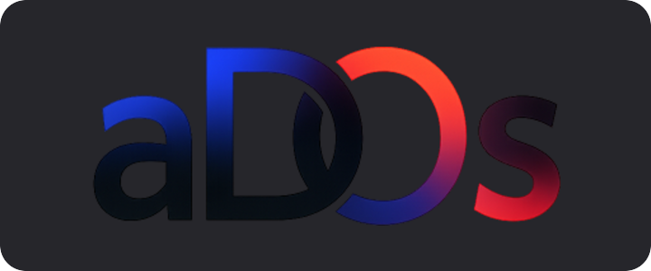

<p align="center"></p>

# aDOs for Windows

> **This is the native Windows build of aDOs**: the same app as the Linux version, from the same source, ported to Windows 11. It is an early preview. Notes, Tasks, Calendar, Sessions, the assistant and the palette are in; the Terminal and the Browser are not yet. Start at [Install on Windows](#install-on-windows-preview). The rest of this page describes aDOs as a whole, and the Linux version where it says so.

Thankyou Open Source Community

A native desktop workspace for Linux, built in Rust on [GPUI](https://github.com/zed-industries/zed) (through `gpui-kit`) with an embedded [Servo](https://servo.org) browser.

aDOs is one window where your work and your AI agents live together. Notes, a terminal, a browser, tasks and a calendar sit in a tiled workspace. Every agent session (pi, Claude Code, Codex) runs behind one interface, and an always-there assistant can see what you're working on and act inside the app.

Midnight-black, keyboard-first, icon-first. A personal project at v1.0: usable daily, not stable. Linux with X11, plus a Windows 11 preview.

## What works today

| Module | Key | What it does |
|---|---|---|
| Layouts | top bar | Panels split, tab, resize and move by drag. Named layouts (Research, Code, Focus), saved without asking. |
| Command palette | Ctrl+K | Fuzzy search over every action in the app. |
| Quick capture | Ctrl+Shift+K | Type or paste a thought, link, file or image; it lands in Notes → Inbox. |
| Notes | Ctrl+2 | Markdown files with list, search, autosave and preview, plus the Inbox of captures. |
| Terminal | Ctrl+3 | A real shell in a PTY: colours, scrollback, copy and paste, vim and htop work. History is restored after a restart. |
| Browser | Ctrl+4 | Servo pages inside a panel: tabs, tiled tabs (side by side, stacked, grid) and follower tabs, popups opened as tabs, an address bar, back/forward and reload, keyboard into the page. Vimium-style `f`/`F` link hints. Switches to Chromium by itself for sites on a list (YouTube by default) or when Servo cannot load a page. |
| Sessions | Ctrl+6 | Every agent session from every backend in one list. Replay, continue, and answer permission prompts. |
| Tasks | Ctrl+7 | My Day and All views. Quick add understands `Pay rent fri #home`. Delete has Undo. |
| Calendar | Ctrl+8 | Day, Week and Agenda views. Native events, plus read-only `.ics` subscriptions. |
| Assistant | Alt+Space | A small card that chats with pi, Claude Code or Codex and knows what the active panel shows. |
| Settings | Ctrl+Alt+, | Interface zoom (75 to 150 %), startup layout, the Browser's Chromium list. |
| Shortcuts | Ctrl+, | Rebind any key. Conflicts are detected and resolved with Swap or Replace. Stored in `keymap.toml`. |
| Hint mode | Ctrl+; | Keyboard hints across the whole app. |

Agents reach aDOs through a built-in **MCP server**: 27 tools covering actions, context, layouts, notes, capture, tasks, calendar, sessions and the browser. Every change an agent makes shows a toast with Undo.

## Architecture

```
crates/
  ados             shell: window, rail, top bar, dock, layouts, settings, shortcut editor
  ados-core        shared contracts: paths, context hub, action registry, shortcuts, overlays
  ados-agents      agent backends over ACP (pi-acp, claude-agent-acp, codex-acp), shared and idle-stopped
  ados-assistant   the assistant card
  ados-sessions    Sessions module
  ados-mcp         aDOs as MCP tools for agents (stdio bridge to a secret-gated Unix socket)
  ados-notes       Notes and Inbox
  ados-terminal    Terminal
  ados-browser     Browser (Servo child window; Chromium fallback)
  ados-palette     command palette and quick capture
  ados-tasks       Tasks
  ados-calendar    Calendar
  ados-script      trial of hot-reloaded script panels (gpui-shell)
```

Agent backends are listed in `ADOS_HOME/backends.toml`. All data lives under `ADOS_HOME` (default `~/.local/share/ados`).

## Install

aDOs runs on **Linux with X11**. A native **Windows 11** preview without the Terminal and Browser exists: see [Install on Windows](#install-on-windows-preview). There is no macOS build.

| Your system | How |
|---|---|
| Ubuntu, Debian, Mint, Pop!_OS | Steps 1 to 5 below, the Ubuntu package list. |
| Fedora | Steps 1 to 5, the Fedora list. |
| Arch, Manjaro | Steps 1 to 5 with: `sudo pacman -S base-devel clang cmake pkgconf fontconfig freetype2 libx11 libxi libxrandr libxcursor libxcb libxkbcommon libxkbcommon-x11 wayland vulkan-icd-loader mesa alsa-lib openssl dbus` |
| Another distro | Install the same libraries under your distro's names: a C/C++ compiler, clang, cmake, pkg-config, and the development files for fontconfig, freetype, X11/xcb, xkbcommon and xkbcommon-x11, wayland, vulkan, gbm, alsa, openssl, dbus. |
| A Wayland desktop | Works through XWayland: start with `WAYLAND_DISPLAY= target/debug/ados`. |
| Windows 11 | The native preview below, or the full Linux app in WSL2 (it ships a Linux display, WSLg): `wsl --install -d Ubuntu-24.04`, then follow the Ubuntu steps inside it. |
| Windows 10 | WSL2 as above; the native build is Windows 11 only for now. |
| macOS | Use a Linux virtual machine (UTM or VirtualBox with Ubuntu 24.04, 8 GB of memory or more), then follow the Ubuntu steps inside it. |

Only Fedora and Ubuntu 24.04 have been built and run. The Arch list, WSL2 and a macOS virtual machine are untested: expect to fix small things, and the Browser is the part most likely to need them.

1. Rust through [rustup](https://rustup.rs); the toolchain (1.99.1) is pinned in `rust-toolchain.toml` and installs itself.
2. System packages.
   - Ubuntu 24.04 (the tested list; `scripts/cloud-setup.sh` installs it together with the test rig):
     ```sh
     sudo apt install build-essential clang libclang-dev pkg-config cmake \
       libfontconfig1-dev libfreetype6-dev libx11-dev libxi-dev libxrandr-dev libxcursor-dev \
       libxcb1-dev libxcb-render0-dev libxcb-shape0-dev libxcb-xfixes0-dev \
       libxkbcommon-dev libxkbcommon-x11-dev libwayland-dev libvulkan-dev libgbm-dev \
       libasound2-dev libssl-dev libdbus-1-dev mesa-vulkan-drivers
     ```
   - Fedora (derived from the Ubuntu list, not test-built):
     ```sh
     sudo dnf install gcc gcc-c++ clang clang-devel pkgconf-pkg-config cmake \
       fontconfig-devel freetype-devel libX11-devel libXi-devel libXrandr-devel libXcursor-devel \
       libxcb-devel libxkbcommon-devel libxkbcommon-x11-devel wayland-devel vulkan-loader-devel \
       mesa-libgbm-devel alsa-lib-devel openssl-devel dbus-devel mesa-vulkan-drivers util-linux
     ```
3. Servo, for the Browser (a prebuilt nightly, 2026-11-17 or newer):
   ```sh
   mkdir -p ~/Apps/servo
   curl -L https://github.com/servo/servo-nightly-builds/releases/download/2026-11-17/servo-x86_64-linux-gnu.tar.gz | tar xz -C ~/Apps/servo
   ~/Apps/servo/servo/servoshell --version
   ```
   aDOs looks for it in `ADOS_SERVO` (a full path), then `~/Apps/servo`, then `servoshell` on `PATH`. Video in Servo needs the GStreamer runtime libraries. Without Servo the Browser says so in one sentence and the rest of the app works.
4. Optional: a Chromium-family browser on `PATH` (`chromium`, `chromium-browser`, `google-chrome`, `vivaldi`), for the automatic switch. Not a snap build.
5. Build and run:
   ```sh
   cargo build -p ados
   target/debug/ados                                   # your data in ~/.local/share/ados
   ADOS_HOME=$PWD/target/try target/debug/ados         # a throwaway data folder
   ```
   A cold build takes about 6 minutes on 4 cores. `./run` builds and starts in one step.

## Install on Windows (preview)

A native Windows 11 (x64) build, made and started by GitHub Actions on every push to `main` (`.github/workflows/windows.yml`). Few people have run it on a real PC yet.

| Part | On Windows |
|---|---|
| Notes, Tasks, Calendar, Sessions, assistant, palette, capture, layouts, Settings, shortcuts | In the build |
| Terminal | Not yet ("Not in this build yet."); planned on ConPTY, PowerShell 7 when installed, else Windows PowerShell |
| Browser | Not yet; planned on WebView2 (part of Windows 11) |
| Agent tools over MCP | Not yet; planned over a named pipe |

1. Download the `aDOs-windows-x64` zip from a green run of the **Build** workflow (Actions tab, signed in to GitHub), or get it from someone who has. In your own fork, turn on Actions first (Actions tab) to build it there.
2. Unzip it anywhere and run `ados.exe`. The app is not signed yet: on "Windows protected your PC", choose More info, then Run anyway.
3. Your data is in `%APPDATA%\ados` (`ADOS_HOME` overrides it). Agents need Node.js (`npx`) as on Linux.

The zip holds a `README.txt` with the same steps for someone who does not read this page.

**Floating cards over web pages (when the Browser arrives).** A web page is a native window (Linux: an X11 child window; Windows: WebView2) that always draws on top of aDOs. When a floating card such as the assistant or a comment card opens over a page, aDOs cuts a card-shaped hole in the page window so the rest of the page stays visible and clicks in the hole reach the card. If the system cannot cut holes (an X server without the SHAPE extension; on Windows, if the window-region method fails on that PC), the page hides while the card is open and returns when it closes. Nothing is lost either way.

Build it yourself on Windows: install Rust through rustup and the Visual Studio Build Tools (C++ workload, with the Windows SDK), then
`cargo build -p ados --release --no-default-features --features notes,assistant,palette,calendar,sessions,tasks`.

## Agents (optional)

The app works without any agent; the assistant then says it cannot reach one. Backends speak the Agent Client Protocol and are listed in `ADOS_HOME/backends.toml` (format in `docs/design/backends.md`). The defaults expect Node with `npx` (the first use downloads the adapters from npm) and the agent you want already installed and signed in: pi (a terminal coding agent) through `pi-acp`, Claude Code through `claude-agent-acp`, Codex through `codex-acp`.

## Tests

```sh
cargo test --workspace          # needs roughly 15 GB of memory for the first build
scripts/cloud-rig.sh up         # the app on a virtual display (Xvfb, xfwm4, xdotool, scrot), for UI checks
scripts/focus-matrix.sh enter leave click overlays   # Browser focus rules, see docs/design/focus-contract.md
```

`scripts/rig.sh` is the same rig on `xspace`, the author's own virtual-display tool; use `cloud-rig.sh` if you do not have it. The browser engines' control ports listen on 127.0.0.1 without a password, which is fine on a single-user machine.

## Docs

- `docs/VISION.md`: where aDOs is going, and the build order.
- `docs/SPEC.md`: the v1 spec and design rules.
- `docs/design/`: design notes (agent backends and MCP, focus contract, shortcuts, script UI, decisions).
- `docs/design/windows-port.md`: the Windows port plan, what is done and what is next.
- `docs/windows/README.txt`: the read-me shipped in the Windows zip.
- `docs/HISTORY.md`: how it was built, and where the old material went.
- `AGENTS.md`: rules for AI agents working in this repo.

In the app, `Ctrl+,` lists every shortcut.

## Roadmap

| Step | Status |
|---|---|
| 1. Agent backends (ACP) | Done |
| 2. Sessions module | Done |
| 3. Assistant tools over aDOs (MCP) | Done |
| 4. Native memory and context engine | Design under discussion (`docs/design/decisions-2026-11-15.md`) |
| 5. Tasks and Calendar | Done |
| 6. Hot-reloaded UI layer the assistant can edit | Trial panel (`ados-script`); gpui-shell chosen for Home |
| v1.0 | Signed off 15 Nov 2026 with 2 known bugs, 0 blockers |
| Browser tabs, tiles, focus, Settings, Chromium switch | Done (16 to 18 Nov 2026) |
| Windows port: shell, data folder, one window, agents | Preview (19 Nov 2026) |
| Windows port: MCP, Terminal (ConPTY), Browser (WebView2), installer | Next, in that order (`docs/design/windows-port.md`) |

## Licence

Licensed under either of the MIT licence (`LICENSE-MIT`) or the Apache Licence 2.0 (`LICENSE-APACHE`), at your option. Fork it and build what you like.

The bundled Lucide icons are ISC (`crates/ados-browser/icons/LICENSE-LUCIDE`). Servo and Chromium are separate programs under their own licences.
